# E2 - Pruebas de controles del ambiente AWS

Fecha de ejecución: 2026-11-26 (UTC 16:12-16:18). Cuenta utv, región us-east-2. Estado del ambiente: pilas permanentes (`utv-network`, `utv-identity`, `utv-operations`) y pila `utv-workload` levantada para esta sesión (EC2 t3.micro `utv-web-01`, RDS `utv-db-01`). Las salidas en bruto, sanitizadas (`<ACCOUNT_ID>`, `<PUBLIC_IP>`, `<PUBLIC_DNS>`), están en `docs/borrador/E2/pruebas/P01..P10.txt`. Inventario de referencia: `01_inventario_ambiente_aws.md`. La prueba de restauración de respaldo no se repite; ver EV-E2-14.

## Resumen

| ID | Prueba | Control / flujo | Resultado |
|---|---|---|---|
| P01 | HTTPS desde internet al servidor web | F-01, A06 | PASS |
| P02 | SSH (22) no accesible desde internet | Filtrado (SG), A06 | PASS |
| P03 | Administración solo por SSM | Acceso administrativo, A06 | PASS |
| P04 | Segmentación web -> datos | F-03, A03/A09, SG/NACL | PASS |
| P05 | AssumeRole sin MFA denegado | Identidad (utv-identity) | PASS con limitación |
| P05b | Condición de MFA aislada (simulación de políticas) | Identidad (utv-identity) | PASS (simulación) |
| P06 | SCP deniega GuardDuty | Control preventivo organizacional | PASS |
| P07 | Alarma de llamadas API no autorizadas | Detección (utv-operations) | PASS |
| P08 | CloudTrail registra los eventos denegados | Registro de auditoría | PASS |
| P09 | Flow Logs registran REJECT al puerto 22 | Registro de red | PASS con limitación |
| P10 | Roles IAM con condición de MFA y política de contraseñas activa | Identidad (utv-identity) | PASS (lectura por CLI) |

## P01 - HTTPS desde internet (F-01)

- Propósito: confirmar que el servidor web publica HTTPS.
- Comando: `curl -k -s -o /dev/null -w "%{http_code}" --max-time 15 https://<PUBLIC_DNS>/`
- Esperado: 200. Observado: 200. Resultado: PASS. Evidencia: `pruebas/P01.txt`; ver EV-E2-05.

## P02 - SSH no alcanzable

- Propósito: confirmar que no hay administración por SSH desde internet.
- Comandos: conexión TCP al puerto 22 de `<PUBLIC_IP>` con tiempo límite de 10 s; `aws ec2 describe-security-groups` del grupo web.
- Esperado: sin conexión y sin regla de ingreso al 22. Observado: la conexión terminó por tiempo límite (código 124); el único ingreso del grupo web es tcp/443 desde 0.0.0.0/0. Resultado: PASS. Evidencia: `pruebas/P02.txt`.

## P03 - Administración solo por SSM

- Propósito: confirmar que la administración se hace por Systems Manager.
- Comandos: `aws ssm describe-instance-information`; `aws ssm send-command` con `hostname`.
- Esperado: instancia Online y comando ejecutado. Observado: PingStatus Online; comando en estado Success, devolvió el nombre de host interno. Resultado: PASS. Evidencia: `pruebas/P03.txt`.

## P04 - Segmentación web -> datos (F-03)

- Propósito: comprobar que el servidor web no alcanza la base de datos por el puerto 5432 (solo la capa de aplicaciones lo tiene permitido) y que la base es privada y cifrada.
- Comandos: por SSM en la EC2, `timeout 5 bash -c '</dev/tcp/<RDS_ENDPOINT>/5432' && echo OPEN || echo BLOCKED`; `aws rds describe-db-instances`.
- Esperado: BLOCKED; PubliclyAccessible=false; StorageEncrypted=true. Observado: BLOCKED; False; True. Resultado: PASS. Evidencia: `pruebas/P04.txt`; ver EV-E2-06.

## P05 - AssumeRole sin MFA

- Propósito: comprobar que los roles `UtvAdminRole` y `UtvAuditorRole` no se asumen sin MFA.
- Comando: `aws sts assume-role --role-arn <rol> --role-session-name t7` (sin `--serial-number`), para ambos roles.
- Esperado: AccessDenied. Observado: AccessDenied en ambos. Resultado: PASS con limitación.
- Limitación: el mensaje de error no menciona MFA; el llamante (el rol de acceso de la cuenta) no figura en la política de confianza de los roles, por lo que la denegación no aísla la condición de MFA. La condición de MFA no se probó positivamente con un dispositivo MFA. Evidencia: `pruebas/P05.txt`.

## P05b - Condición de MFA aislada (simulación de políticas)

- Propósito: aislar la condición `aws:MultiFactorAuthPresent` que P05 no pudo aislar. Es una prueba de simulación de políticas, no un inicio de sesión real con un dispositivo MFA.
- Comando: `aws iam simulate-custom-policy` (solo lectura) con la sentencia de la política de confianza de `UtvAdminRole` convertida a política de identidad, y con la política `UtvDenyWithoutMfa` tal como está desplegada, variando el contexto `aws:MultiFactorAuthPresent`.
- Esperado: sin MFA, denegación; con MFA, permitido. Observado: `sts:AssumeRole` sobre `UtvAdminRole`: MFA=false implicitDeny, MFA=true allowed, clave ausente implicitDeny. `UtvDenyWithoutMfa`: `ec2:DescribeInstances` explicitDeny con MFA=false o ausente y allowed con MFA=true; `iam:ListMFADevices` allowed en ambos casos (excepción prevista para registrar el MFA). Resultado: PASS (simulación).
- Limitación: simular la política de confianza como política de recurso devolvió allowed en todos los casos (el simulador no la exige como requisito adicional), por lo que se usó la conversión a política de identidad; solo se simuló `UtvAdminRole` (el auditor usa la misma condición). Sigue pendiente un `AssumeRole` real con MFA. Evidencia: `pruebas/P05b.txt`.

## P06 - SCP preventivo

- Propósito: confirmar el control preventivo de la organización.
- Comando: `aws guardduty create-detector --enable` (una sola llamada).
- Esperado: AccessDenied por SCP. Observado: AccessDeniedException "with an explicit deny in a service control policy" (p-kofx9sib); no se creó nada. Resultado: PASS. Evidencia: `pruebas/P06.txt`; ver EV-E2-02.

## P07 - Alerta de llamadas no autorizadas

- Propósito: comprobar que las denegaciones de P05/P06 activan la alarma `utv-UnauthorizedApi`.
- Comando: sondeo de `aws cloudwatch describe-alarms` cada 60 s y `describe-alarm-history`.
- Esperado: transición a ALARM. Observado: OK a las 16:12-16:14 UTC; ALARM a las 16:15:19 UTC (OK -> ALARM en el historial). Resultado: PASS. Evidencia: `pruebas/P07.txt`.
- Notificación de extremo a extremo: confirmada por el usuario, que observó en su bandeja el correo de AWS Notifications "ALARM: utv-UnauthorizedApi in US East (Ohio)": cambio de estado OK -> ALARM, jueves 26 de noviembre de 2026, 16:15:19 UTC, umbral 5.0 (1 punto de datos de 5.0), espacio de nombres UTV/Security. Fuente: observación del usuario; el agente no leyó el correo y no se guarda copia.
- Si el correo se usa como captura, enmascarar el ID de cuenta, los ARN y el enlace de baja de suscripción (contiene la dirección).
- Captura: C07 (historial de la alarma) y C13 (correo de alarma SNS recibido), en la sección Capturas.

## P08 - Pista de auditoría

- Propósito: confirmar que CloudTrail registra los eventos denegados.
- Comando: `aws cloudtrail lookup-events` por `AssumeRole` y `CreateDetector`, filtrando eventos con `errorCode`.
- Observado: 2 `AssumeRole` AccessDenied (16:12:41 y 16:12:42 UTC) y 1 `CreateDetector` AccessDenied (16:12:43 UTC). Resultado: PASS. Evidencia: `pruebas/P08.txt`.

## P09 - VPC Flow Logs

- Propósito: confirmar registros REJECT hacia el puerto 22 de la instancia web.
- Comando: `aws logs filter-log-events` sobre `/utv/vpc/flowlogs`, patrón REJECT al puerto 22, últimos 30 min.
- Observado: 3 registros REJECT (puerto destino 22, interfaz de la instancia web, IP privada 10.30.2.44) desde direcciones externas. Resultado: PASS con limitación: los orígenes son escáneres de internet (IP enmascaradas); el intento propio de P02 no es atribuible individualmente a un registro, pero el control (rechazo del 22) queda observado. Evidencia: `pruebas/P09.txt`.

## P10 - Roles IAM y política de contraseñas

- Propósito: verificar de nuevo, en solo lectura, que los roles de identidad existen con la condición de MFA y que la política de contraseñas de la cuenta está activa.
- Comandos (perfil utv): `aws iam get-account-password-policy`; `aws iam list-roles` filtrado por `Utv*`; `aws iam get-role`, `list-attached-role-policies`, `list-role-policies` y `get-policy-version` para `UtvAdminRole`, `UtvAuditorRole` y `UtvDenyWithoutMfa`.
- Observado: existen `UtvAdminRole`, `UtvAuditorRole`, `UtvBackupRole` y `UtvEc2Role`. La política de confianza de `UtvAdminRole` y de `UtvAuditorRole` permite `sts:AssumeRole` al principal raíz de la cuenta solo con `Bool aws:MultiFactorAuthPresent = "true"`. `UtvAdminRole` tiene adjuntas `PowerUserAccess` y `UtvDenyWithoutMfa`; `UtvAuditorRole`, `SecurityAudit` y `UtvDenyWithoutMfa`; ninguno tiene políticas en línea. `UtvDenyWithoutMfa` deniega todo salvo el registro de MFA y el cambio de contraseña cuando `aws:MultiFactorAuthPresent` es falso o está ausente. Política de contraseñas activa: longitud mínima 14, símbolos, números, mayúsculas y minúsculas obligatorios, caducidad a 90 días, no reutilizar las últimas 24, cambio de contraseña permitido al usuario. Resultado: PASS.
- Alcance: es una lectura de la configuración desplegada; no es un inicio de sesión con MFA (ver P05 y P05b). La página "Configuración de cuenta" de la consola de IAM muestra "Característica no disponible" en esta cuenta miembro de la organización, así que la política de contraseñas (C11) se evidencia con la salida de CLI de P10 y no con una captura de esa página. Los roles y la condición de MFA sí se ven en consola: C11b y C11c. Evidencia: `pruebas/P10_iam.txt`.

## Hallazgos y limitaciones

- P05: la condición de MFA no se aisló en la prueba real; P05b la aísla por simulación; falta una prueba con credenciales MFA reales.
- P09: ver limitación de atribución.
- Brecha de RPO (inventario, L9): el BIA de Gestión Académica exige RPO de 1 h y el plan de respaldo es diario (24 h); sigue abierta para el tratamiento de riesgos E4.
- Restauración de respaldo: no repetida; resultado en EV-E2-14.
- GuardDuty, Security Hub e Inspector siguen bloqueados por SCP; la detección se sustituye por alarmas de CloudTrail/CloudWatch (P07).

## Capturas

Capturas de consola tomadas el 2026-11-26 (UTC) con la cuenta utv, región us-east-2 (consola en español), en una sesión de Brave que el usuario abrió y autenticó; el agente no leyó credenciales, cookies ni almacenamiento. Cada PNG es solo el contenido de la página: se ocultó la barra superior (cuenta, nombre de usuario) y la barra de direcciones no aparece. En cada captura se enmascararon el ID de cuenta (se deja solo `********9132`), la cuenta de administración de la organización, direcciones IP públicas, DNS públicos, endpoints, correos y claves de acceso. La carga (EC2 y RDS) se levantó solo para C03 a C05b y se volvió a desmontar. **Diseñado vs implementado:** todas las capturas muestran recursos implementados en la cuenta; la VPN y los servicios bloqueados por SCP no aparecen porque solo están diseñados.

**Revisión de redacción:** las 18 capturas se revisaron una por una. Los datos sensibles que quedaban se taparon con rectángulos negros sobre el propio PNG (ARN del secreto de la base de datos y su sufijo, identificador de recurso de RDS, últimos dígitos de la cuenta de administración de la organización); el resto ya estaba enmascarado en la página y se comprobó que no quedaran restos. Del ID de cuenta se conservan solo los últimos 4 dígitos.

**C11 (política de contraseñas) no se evidencia con captura:** la página IAM > Configuración de cuenta muestra "Característica no disponible" en esta cuenta miembro de la organización. La política (`infra/aws/password-policy.json`) se evidencia con la salida de CLI de P10 (`pruebas/P10_iam.txt`). En su lugar se tomaron C11b y C11c, que muestran los roles de identidad y la condición de MFA.

**Captura C01. Subredes de la VPC utv (diseñado y desplegado)**

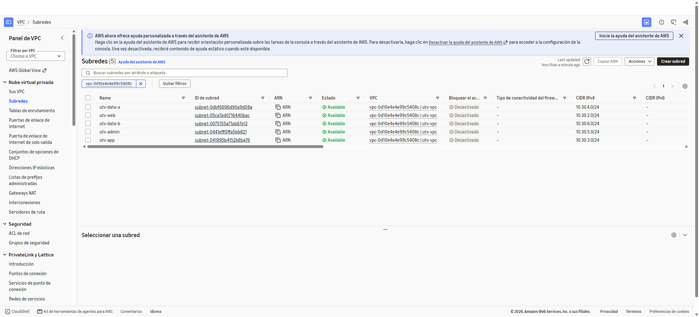

Cinco subredes de la VPC `utv-vpc` con sus CIDR: web 10.30.2.0/24, app 10.30.3.0/24, data-a 10.30.4.0/24, admin 10.30.5.0/24 y data-b 10.30.6.0/24 (segunda zona de datos), todas en estado Available. Vinculada a P04, EV-E2-04.

**Captura C02. Grupo de seguridad web: solo 443 de entrada**

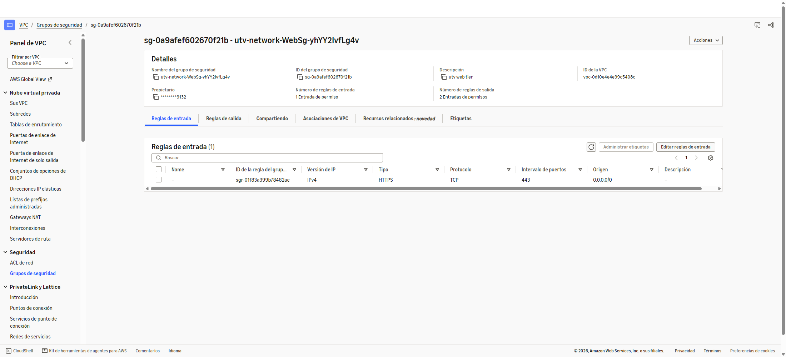

Reglas de entrada del grupo web: una sola regla, HTTPS/TCP 443 desde 0.0.0.0/0; no existe regla para el puerto 22. Vinculada a P01, P02.

**Captura C03. Instancia web: detalle (estado, subred, rol IAM, sin key pair)**

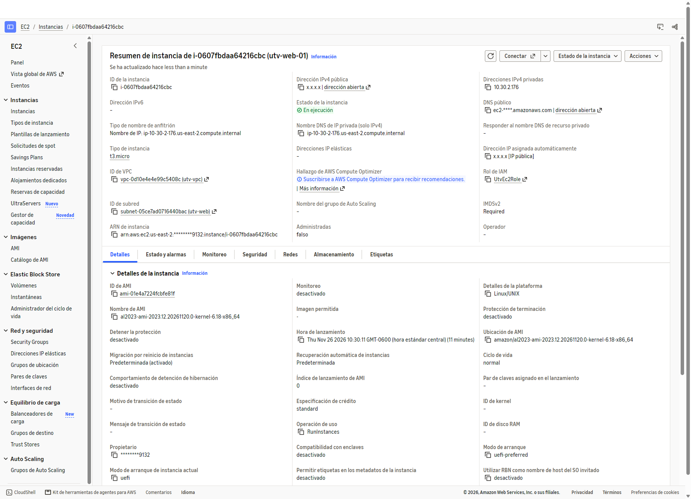

`utv-web-01` en ejecución (t3.micro), subred utv-web, rol IAM `UtvEc2Role`, IMDSv2 requerido y "Par de claves asignado en el lanzamiento" vacío. La IP pública y el DNS público se enmascararon. Vinculada a P01, P02, P03.

**Captura C03b. Instancia web: pestaña Seguridad**

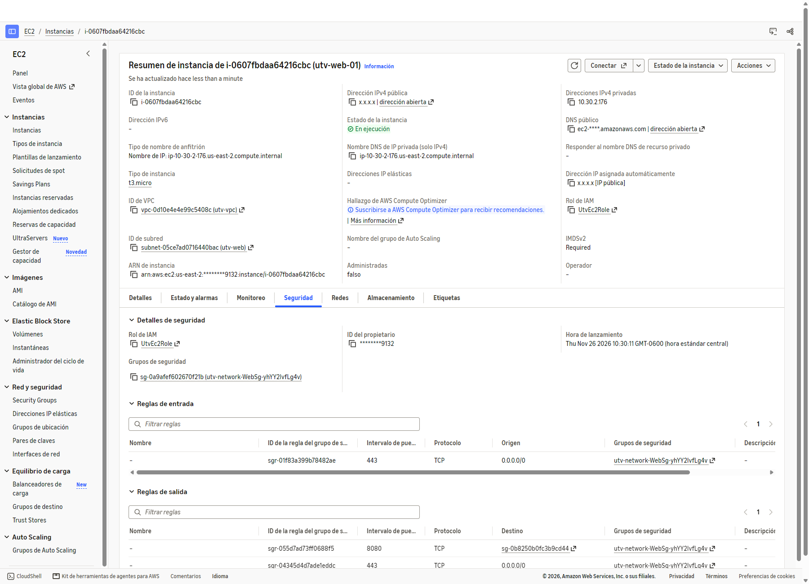

Pestaña Seguridad de la misma instancia: grupo de seguridad `utv-network-WebSg` con solo 443 de entrada, rol `UtvEc2Role`. Complementa C03. Vinculada a P01, P02.

**Captura C04. Nodo administrado en Systems Manager (Online)**

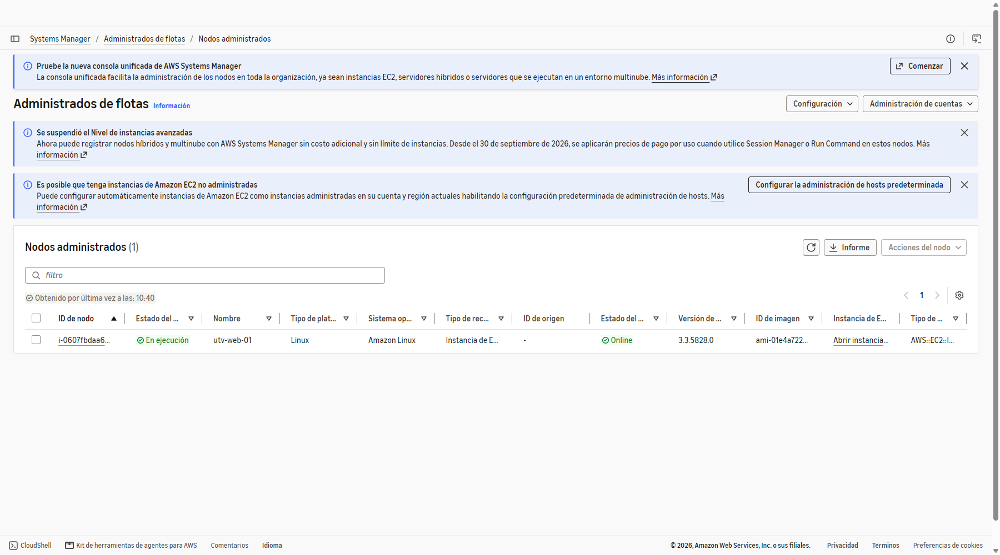

Fleet Manager muestra el nodo `utv-web-01` con estado del nodo Online y estado de la instancia En ejecución; la administración es por SSM, sin SSH. Vinculada a P03.

**Captura C05. RDS utv-db-01: conectividad y seguridad (no público)**

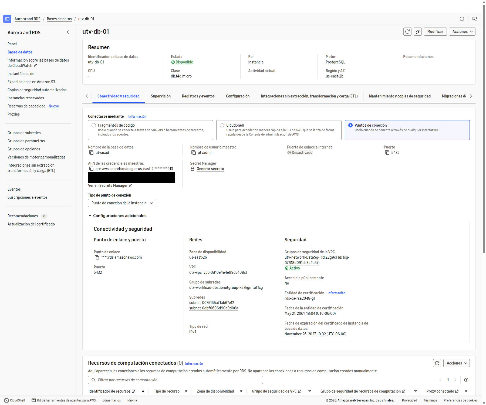

Pestaña Conectividad y seguridad: "Accesible públicamente: No", VPC `utv-vpc`, subredes de datos, grupo de seguridad `utv-network-DataSg`. El endpoint se enmascaró. Vinculada a P04.

**Captura C05b. RDS utv-db-01: configuración (cifrado habilitado)**

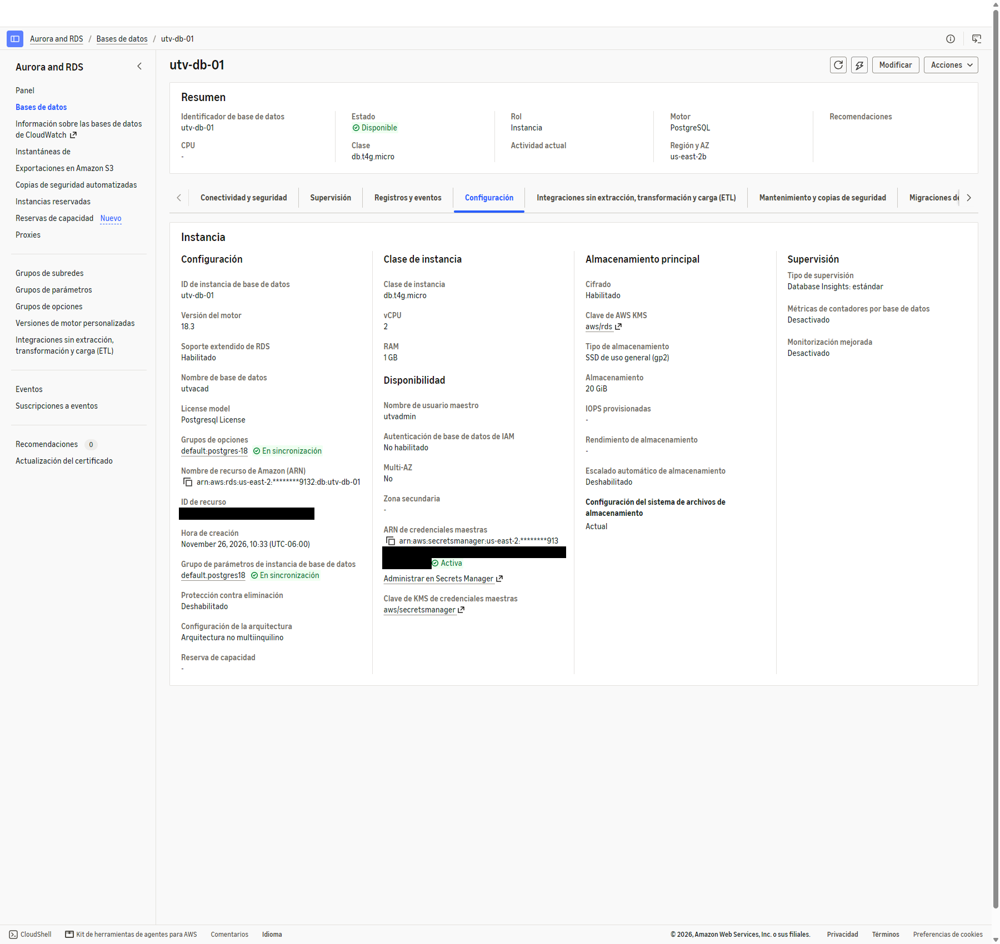

Pestaña Configuración: cifrado Habilitado con la clave aws/rds, Multi-AZ No, clase db.t4g.micro, 20 GiB. Vinculada a P04.

**Captura C06. Listas de control de acceso de red por subred**

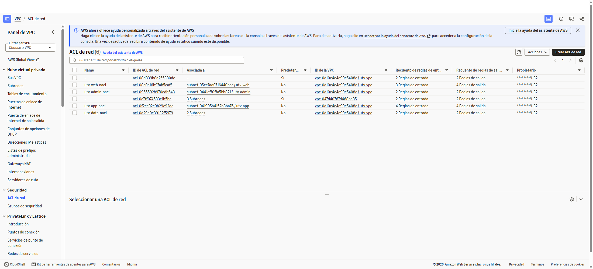

Seis NACL: `utv-web-nacl`, `utv-admin-nacl`, `utv-app-nacl` y `utv-data-nacl` asociadas a las subredes de la VPC `utv-vpc` (más las dos NACL predeterminadas), con su recuento de reglas de entrada y salida. Vinculada a P04, EV-E2-04.

**Captura C07. Historial de la alarma utv-UnauthorizedApi**

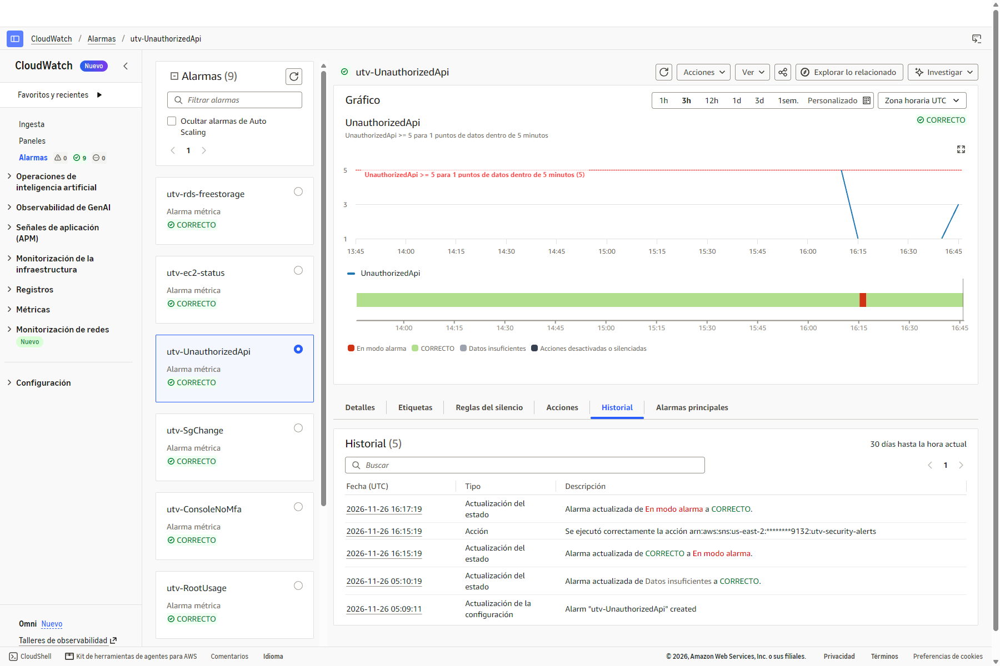

Historial (UTC): CORRECTO -> En modo alarma el 2026-11-26 16:15:19, acción SNS ejecutada correctamente y regreso a CORRECTO a las 16:17:19. El gráfico marca el pico de eventos denegados. Vinculada a P07.

**Captura C08. CloudTrail: evento CreateDetector denegado**

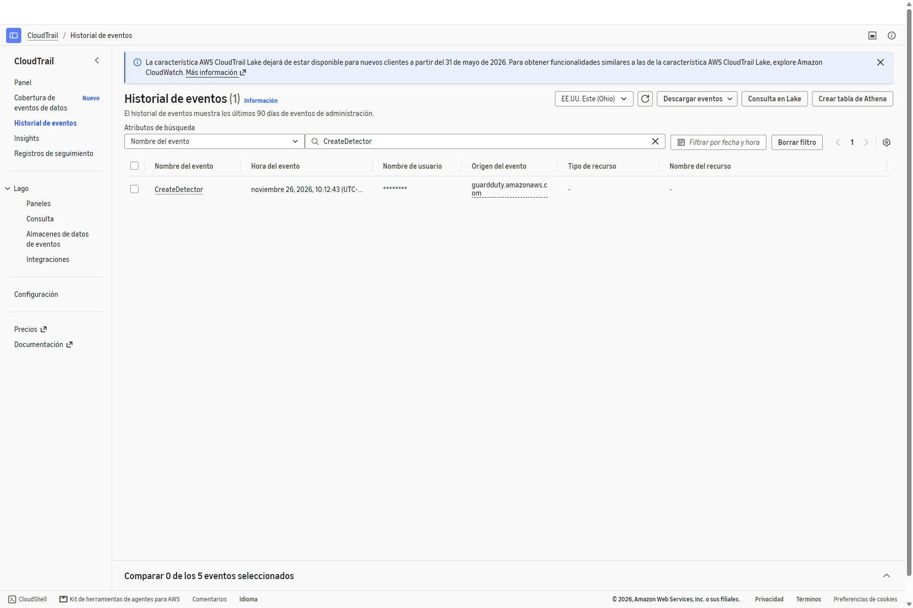

Historial de eventos filtrado por `CreateDetector` (guardduty.amazonaws.com), 26/11/2026 10:12:43 UTC-6 (16:12:43 UTC). El nombre de usuario se enmascaró. Vinculada a P08, P06.

**Captura C08b. CloudTrail: detalle del evento con código AccessDenied**

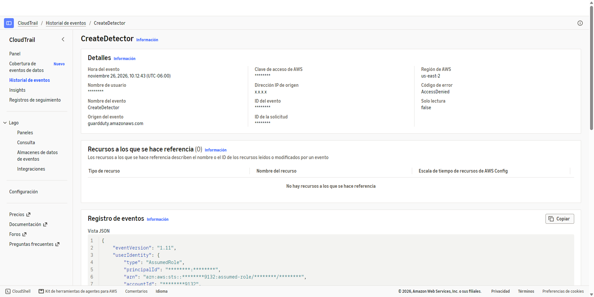

Detalle del mismo evento: "Código de error: AccessDenied", "Solo lectura: false". IP de origen, clave de acceso, ID de evento, nombre del rol y de la sesión enmascarados. Vinculada a P08, P06.

**Captura C09. Logs Insights: REJECT al puerto 22**

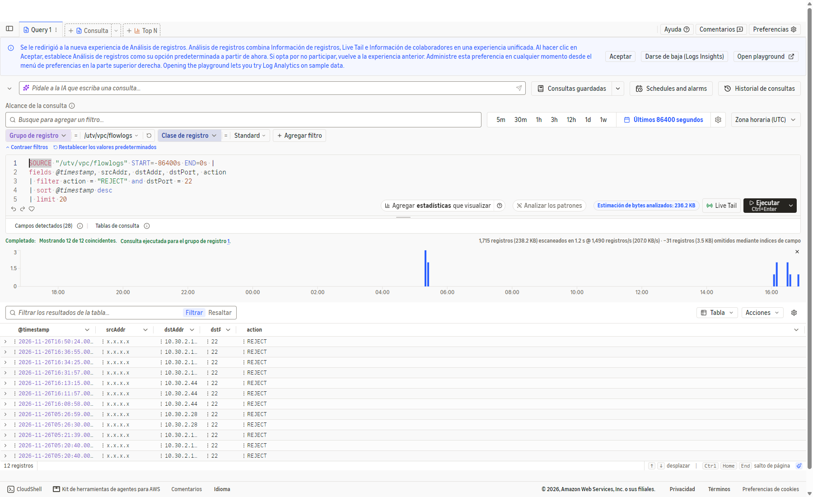

Consulta sobre `/utv/vpc/flowlogs` con `action = "REJECT"` y `dstPort = 22` en las últimas 24 h: 12 registros hacia 10.30.2.x, con la IP de origen enmascarada. Vinculada a P09.

**Captura C10. AWS Backup: almacén y puntos de recuperación**

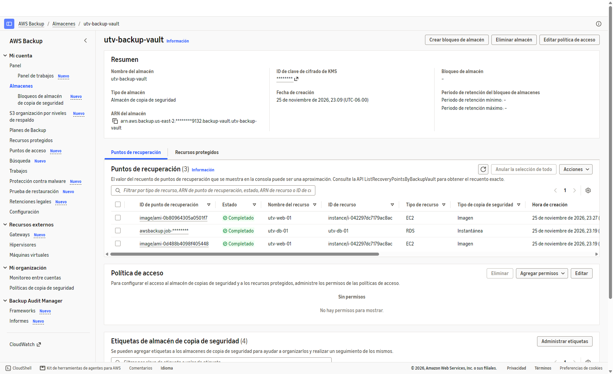

Almacén `utv-backup-vault` con 3 puntos de recuperación en estado Completado (dos imágenes EC2 y una instantánea RDS). Los ID de punto con el ID de cuenta y la clave KMS se enmascararon. Vinculada a EV-E2-14.

**Captura C10b. AWS Backup: trabajos de restauración completados**

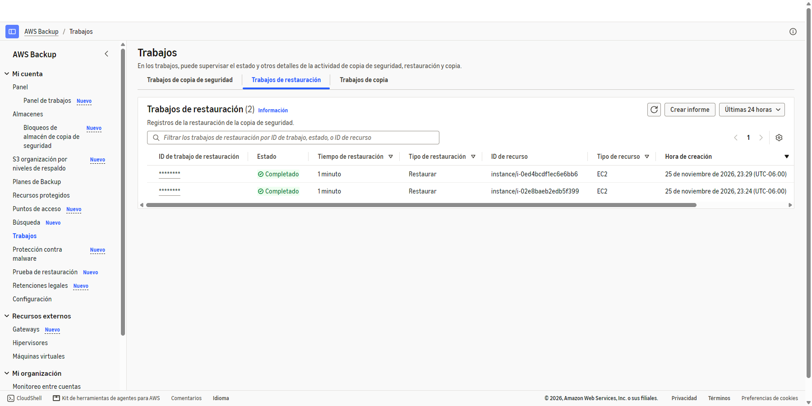

Trabajos de restauración: 2 trabajos Completado (restauración de EC2, 1 minuto cada uno), 25/11/2026 23:24 y 23:29 UTC-6. Vinculada a EV-E2-14.

**Captura C12. Presupuestos de AWS**

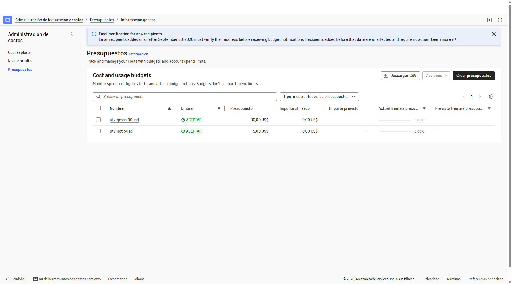

Dos presupuestos de costo: `utv-net-5usd` (5,00 US$) y `utv-gross-30usd` (30,00 US$), ambos en estado ACEPTAR con 0,00 US$ utilizados. Vinculada a EV-E2-01.

**Captura C13. Correo de alarma SNS recibido (prueba P07)**

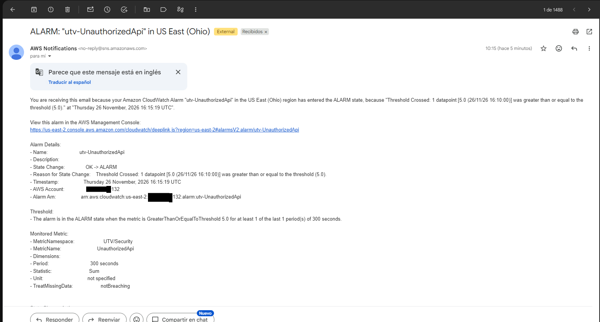

Notificación de AWS Notifications para la alarma `utv-UnauthorizedApi`, con cambio de estado OK -> ALARM el jueves 26 de noviembre de 2026 a las 16:15:19 UTC, umbral 5.0, espacio de nombres UTV/Security. Demuestra la cadena llamada denegada -> CloudTrail -> filtro de métricas -> alarma -> SNS -> correo. El ID de cuenta se enmascaró dejando solo los últimos 4 dígitos, para acreditar que la captura es real sin exponer el identificador completo; la dirección de correo destinataria no aparece en la captura. Vinculada a P07 (`pruebas/P07.txt`).

**Captura C11b. IAM: roles de la cuenta**

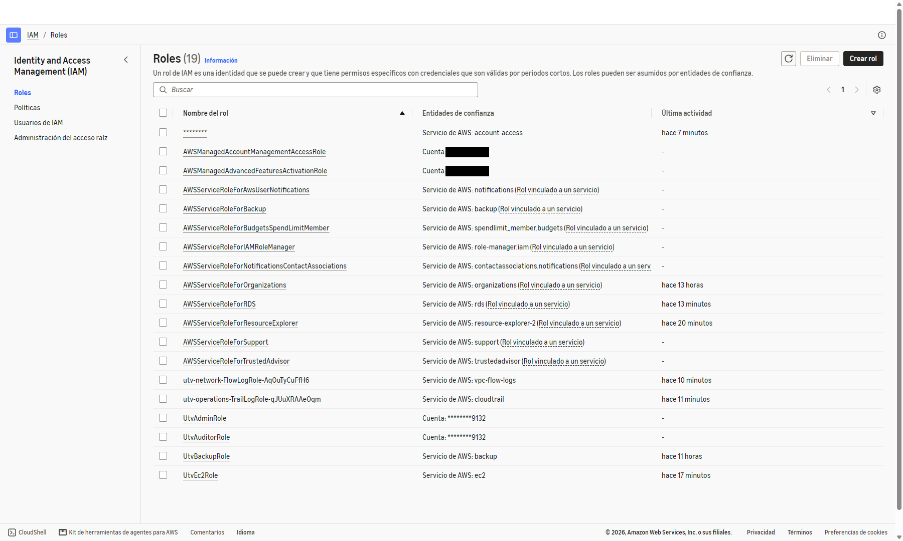

Lista de los 19 roles de la cuenta; entre ellos `UtvAdminRole`, `UtvAuditorRole`, `UtvBackupRole` y `UtvEc2Role` (los dos primeros con entidad de confianza "Cuenta", ID enmascarado). Vinculada a P10.

**Captura C11c. IAM: relación de confianza de UtvAdminRole**

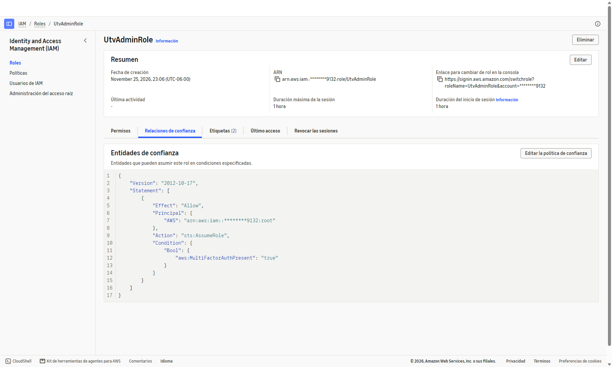

Pestaña "Relaciones de confianza" de `UtvAdminRole`: `sts:AssumeRole` con `"aws:MultiFactorAuthPresent": "true"`. Vinculada a P10 y P05b.
